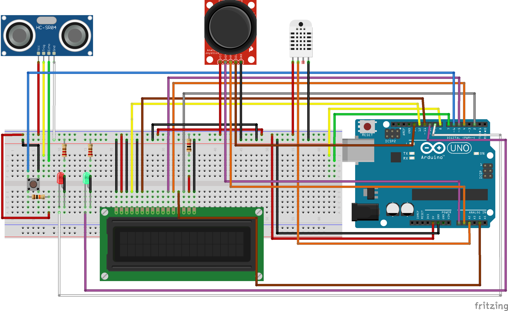

# Práctica 3 — Máquina expendedora con Arduino UNO
**Asignatura:** Sistemas Empotrados y de Tiempo Real 
**Autora:** Claudia Morales Rojas


## 1. Objetivo y montaje

He programado un controlador de máquina expendedora con Arduino UNO. Detecta a un cliente mediante ultrasonidos, muestra temperatura y humedad, permite escoger una bebida y simula su preparación. Además, dispone de un menú de Administración para consultar medidas y modificar precios.

### Esquema del circuito
He realizado el montaje en protoboard y su representación en Fritzing.

| Componente | Conexión a Arduino UNO |
|---|---|
| LED1 rojo / LED2 verde | D9 / D3 |
| Botón externo / botón del joystick | D2 (INT0) / D13 |
| Joystick X / Y | A0 / A1 |
| DHT11 | A2 |
| HC-SR04 TRIGGER / ECHO | D8 / D7 |
| LCD (RS, E, D4, D5, D6, D7) | D12, D11, D5, D4, A4, D6 |
El botón externo tiene una **resistencia pull-up externa** y está configurado como `INPUT`. Para el botón del joystick utilizo `INPUT_PULLUP`, aprovechando la resistencia interna. Así, ambos presentan HIGH sin pulsar y LOW al pulsarlos, evitando entradas flotantes. Los **LEDs tienen resistencias en serie** para limitar la corriente; el montaje también incluye una resistencia asociada al LCD.

### Fotografías del montaje


## 2. Funcionamiento

### Arranque
Al encender Arduino, la LCD muestra `CARGANDO ...` y LED1 parpadea mediante interrupciones periódicas de **TimerOne**. Al finalizar la secuencia, el programa pasa al estado de espera.

### Servicio
En espera, la LCD muestra `ESPERANDO` y `CLIENTE` en sus dos filas. El **HC-SR04** toma medidas periódicas y, si detecta una distancia inferior a **100 cm**, se inicia la monitorización: durante **5 segundos** se muestran temperatura y humedad del **DHT11**, con lecturas programadas aproximadamente cada segundo.
Después se muestra un producto y su precio, y el joystick permite recorrer el catálogo. Los precios iniciales son:
| Producto | Precio |
|---|---:|
| Café Solo | 1,00 € |
| Café Cortado | 1,10 € |
| Café Doble | 1,25 € |
| Café Premium | 1,50 € |
| Chocolate | 2,00 € |
Al pulsar el joystick se selecciona la bebida. El LCD muestra `Preparando` y `Cafe...`; la preparación simulada dura entre **4 y 8 segundos**, mediante `random(4000, 8001)`. Durante ese tiempo aumenta el brillo de **LED2** con PWM, según el tiempo transcurrido. Después aparece `RETIRE BEBIDA` durante **3 segundos** y la máquina vuelve a espera. Una pulsación del botón externo de **2 a 3 segundos**, detectada al soltarlo, cancela la operación sin reiniciar la placa.

### Administración
Se entra o sale manteniendo pulsado el botón externo **al menos 5 segundos** (salvo durante Arranque, que el código excluye). Al entrar, se encienden ambos LEDs, aparece `MODO ADMIN` durante **2 segundos** y después se muestra el menú: **Ver temperatura**, **Ver distancia sensor**, **Ver contador** y **Modificar precios**.
Con el joystick se cambia de opción, se confirma con su pulsador y se vuelve atrás moviéndolo a la izquierda. La temperatura y el contador se refrescan cada **1 segundo**, y la vista de distancia cada **250 ms**. En la edición, los precios se modifican en pasos de **0,05 €** y se confirma con el pulsador; al volver a la izquierda se recupera el precio anterior. Los importes se comparten con el catálogo de Servicio y no se guardan en EEPROM.


## 3. Diseño de la solución y recursos utilizados

### 3.1. Organización por archivos y estados
He separado el proyecto en **siete archivos `.ino`**, según su función:
- **`MaquinaExpendedora.ino`:** pines, librerías, `setup()`, `loop()`, tareas y estado de espera.
- **`arranque.ino`:** mensaje inicial y parpadeo del LED1.
- **`presencia.ino`:** medición de distancia por fases.
- **`monitorizacion.ino`:** lectura y visualización del DHT11.
- **`navegacion.ino`:** catálogo, joystick, preparación y retirada.
- **`administracion.ino`:** menú, consultas y modificación de precios.
- **`reinicio.ino`:** interrupción y control de pulsaciones del botón externo.
La variable **`estadoMaquina`** indica qué hace la máquina: **0 arranque, 1 espera, 2 monitorización, 3 selección, 4 preparación, 5 retirada y 6 administración**. En `tareaControlEstados()` se llama a la función correspondiente. He separado los archivos para que cada parte tenga una responsabilidad clara y el programa resulte más fácil de revisar.

### 3.2. ArduinoThread
He utilizado **ArduinoThread** con dos tareas registradas en un `ThreadController`:
- **`tareaBoton` (10 ms):** ejecuta `tareaControlBoton()`, que llama a `procesarBotonExterno()`.
- **`tareaEstados` (1 ms):** ejecuta `tareaControlEstados()` para actualizar la fase de funcionamiento.
El controlador se ejecuta desde `loop()`. Esta separación me permite atender las pulsaciones mientras se realizan otras operaciones. Los *threads* son **cooperativos**, no se ejecutan en paralelo y los intervalos indican cuándo se intenta ejecutar cada tarea, no un tiempo exacto garantizado.

### 3.3. Interrupción hardware del botón
El botón externo está conectado al pin **D2 (INT0)**. Uso `attachInterrupt(..., FALLING)` porque al pulsarlo cambia de HIGH a LOW. La ISR solo pone `eventoBotonPendiente = true`; declaro esa variable **`volatile`** porque se modifica en la interrupción y se consulta fuera de ella. Después, `procesarBotonExterno()` mide la duración con `millis()`. Así mantengo la ISR corta y distingo la cancelación de **2–3 s** del acceso a Administración de **5 s**.

### 3.4. Control temporal y HC-SR04
He utilizado **`millis()`** para los tiempos de menús, pulsaciones, monitorización y preparación, y **`micros()`** para el sensor ultrasónico, que trabaja con pulsos de microsegundos. De esta forma evito `delay()`, que detendría el flujo del programa durante las esperas.
La medida del HC-SR04 se organiza en **cuatro fases (0 a 3)**: activar TRIGGER, mantenerlo HIGH al menos **10 µs** y desactivarlo, esperar a que ECHO suba a HIGH y esperar a que vuelva a LOW. Así no necesito utilizar `pulseIn()`, que podría bloquear la ejecución mientras espera el pulso. Entre mediciones completadas o canceladas dejo al menos **100 ms**, y si ECHO no cambia como se espera tras **25 ms**, cancelo ese intento.
La distancia se calcula con la velocidad del sonido utilizada en el programa:
**Distancia (cm) = tiempo de ECHO (µs) × 0,0343 / 2**.
Divido entre dos porque el sonido recorre la distancia de ida y vuelta.

### 3.5. TimerOne y PWM
Para el Arranque uso **TimerOne**, configurado con `Timer1.initialize(1000000)`, de manera que su ISR se llama aproximadamente cada **1 segundo** y cambia LED1 sin emplear `delay()`.
Durante la preparación, el **LED2 está conectado al pin D3**, que admite PWM y evita utilizar los pines PWM asociados a Timer1. El nivel de brillo se obtiene según la parte del tiempo de preparación que haya transcurrido:
```cpp
nivelPWM = (tiempoTranscurrido * 255) / duracionPreparacion;
if (nivelPWM > 255) nivelPWM = 255;
analogWrite(pinLedPreparacion, nivelPWM);
```
El valor va de **0 a 255**, para que el LED indique visualmente el avance de la preparación. Al inicio del programa utilizo `randomSeed(analogRead(A3))` para inicializar la secuencia pseudoaleatoria de duraciones.

### 3.6. Watchdog
He activado el **Watchdog de 8 segundos** con `wdt_enable(WDTO_8S)` y lo refresco en cada vuelta de `loop()` mediante `wdt_reset()`. Si el programa se bloquea y deja de refrescarlo, Arduino se reinicia. He elegido 8 segundos como margen de seguridad. Este mecanismo no sustituye los tiempos máximos de espera del sensor, porque el Watchdog puede seguir refrescándose aunque una medición no avance.


## 4. Pruebas y resultados
[PENDIENTE: describir qué se ha observado al probar el arranque, la detección de presencia, la selección, la preparación, la cancelación y Administración.]


## 5. Conclusión
La dificultad principal ha sido coordinar sensores, pulsadores, pantalla y LEDs con tiempos diferentes sin utilizar `delay()`. La división en archivos y estados, junto con ArduinoThread, las interrupciones, TimerOne y el Watchdog, me ha permitido organizar el controlador y trabajar los recursos estudiados en la asignatura.
