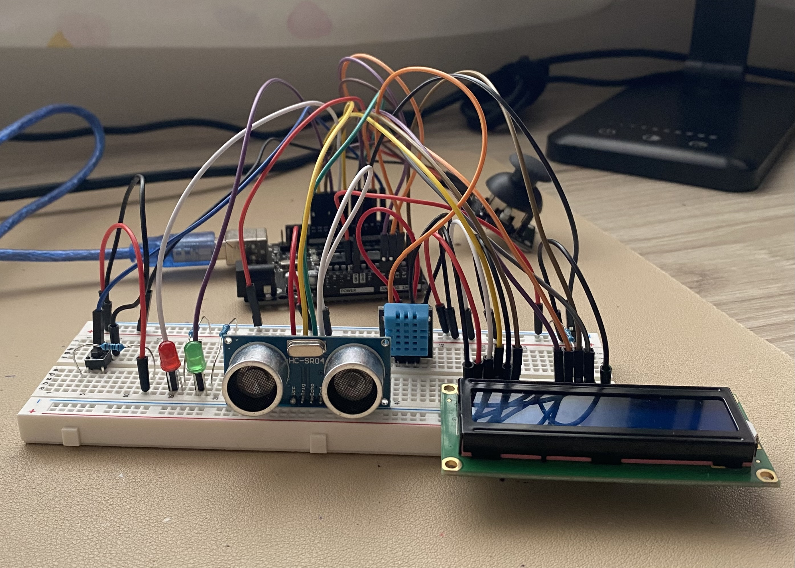
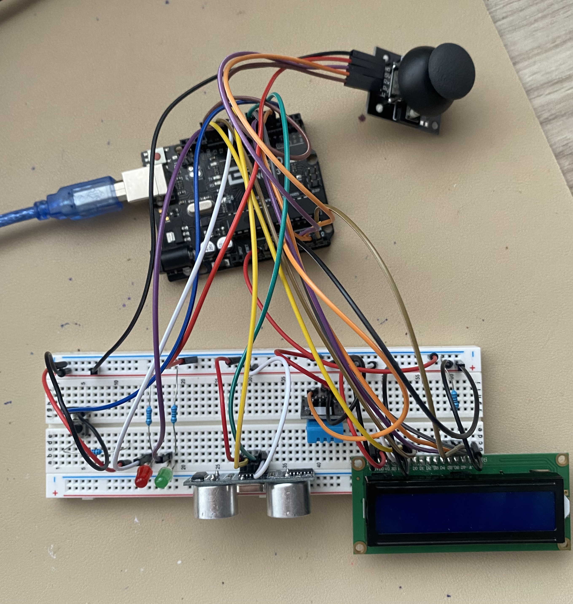
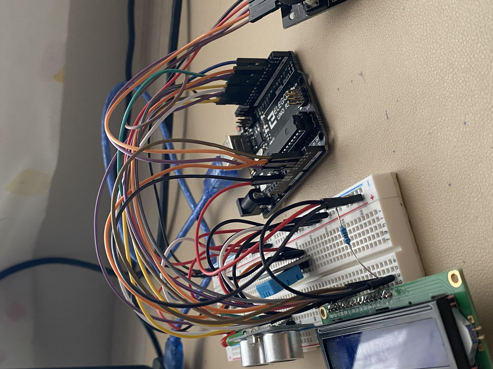

# Práctica 3 — Controlador Máquina Expendedora

**Autora:** Claudia Morales Rojas

## 1. Objetivo y montaje

He desarrollado un controlador de máquina expendedora con Arduino UNO. Detecta clientes mediante ultrasonidos, muestra temperatura y humedad, permite seleccionar bebidas y simula su preparación. También incluye un modo Administración para consultar datos y modificar precios.

### Esquema del circuito

He realizado el montaje en protoboard y su representación en Fritzing.


| Componente | Conexión a Arduino UNO |
|---|---|
| LED1 rojo / LED2 verde | D9 / D10 |
| Botón externo / botón joystick | D2 (INT0) / D13 |
| Joystick X / Y | A0 / A1 |
| DHT11 | A2 |
| HC-SR04 TRIGGER / ECHO | D8 / D7 |
| LCD (RS, E, D4, D5, D6, D7) | D12, D11, D5, D4, A4, D6 |

El botón externo utiliza una **resistencia pull-up externa** y está configurado como `INPUT`, mientras que el joystick utiliza `INPUT_PULLUP` en vez de una física (para ahorrar espacio). Ambos trabajan con HIGH en reposo y LOW al pulsar, evitando entradas flotantes.
Los LEDs llevan resistencias en serie para limitar la corriente. El montaje también incluye una resistencia asociada al LCD.

### Fotografías del montaje





## 2. Funcionamiento

### Arranque

Al encender Arduino, el LCD muestra `CARGANDO ...` y LED1 parpadea tres veces, cambiando de estado cada segundo mediante **ArduinoThread**. Al terminar, se apaga y pasa automáticamente a espera.

### Servicio

En reposo aparece `ESPERANDO CLIENTE`. El HC-SR04 realiza mediciones periódicas y, si detecta una distancia inferior a **100 cm** (1 metro), comienza la monitorización.

Durante **5 segundos** se muestran temperatura y humedad del DHT11. Después aparece el catálogo:

| Producto | Precio |
|---|---:|
| Café Solo | 1,00 € |
| Café Cortado | 1,10 € |
| Café Doble | 1,25 € |
| Café Premium | 1,50 € |
| Chocolate | 2,00 € |

El joystick permite recorrer los productos y seleccionarlos con su pulsador. La preparación dura entre **4 y 8 segundos**, utilizando `random(4000, 8001)`. Durante ese tiempo, LED2 aumenta progresivamente su brillo mediante PWM, proporcionalmente al tiempo transcurrido. Al finalizar, aparece `RETIRE BEBIDA` durante **3 segundos** y el sistema vuelve a espera.
Para cancelar una operación, mantengo el botón externo pulsado entre **2 y 3 segundos**. La cancelación se detecta al soltarlo y devuelve el controlador a espera sin reiniciar la placa.

### Administración

Se accede o sale manteniendo pulsado el botón externo **al menos 5 segundos**, excepto durante el arranque. Al entrar, ambos LEDs se encienden y aparece `MODO ADMIN` durante **2 segundos**, antes de mostrar las cuatro opciones:

- Ver temperatura.
- Ver distancia sensor.
- Ver contador.
- Modificar precios.

El joystick permite navegar verticalmente, confirmar pulsando y retroceder hacia la izquierda.
Las vistas de temperatura, distancia y contador se actualizan cada **1 segundo**. Los precios se modifican en pasos de **0,05 €**; se confirman pulsando el joystick o se descartan moviéndolo a la izquierda sin previamente haber pulsado. Los precios modificados se comparten con el catálogo de Servicio, sin necesidad de EEPROM.

## 3. Diseño de la solución y decisiones de implementación

### 3.1. Organización por archivos y estados

He dividido el proyecto en **siete archivos `.ino`**, separando responsabilidades:

| Archivo | Función |
|---|---|
| `MaquinaExpendedora.ino` | Configuración, tareas y control principal |
| `arranque.ino` | Secuencia inicial |
| `presencia.ino` | Medición ultrasónica |
| `monitorizacion.ino` | Lecturas y visualización del DHT11 |
| `navegacion.ino` | Selección y preparación de bebidas |
| `administracion.ino` | Menú y modificación de precios |
| `reinicio.ino` | Interrupción y duración de pulsaciones |

Utilizo la variable **`estadoMaquina`** para controlar las distintas fases: `0` Arranque · `1` Espera · `2` Monitorización · `3` Selección · `4` Preparación · `5` Retirada · `6` Administración.
Esta organización evita mezclar funcionalidades y permite ejecutar únicamente las operaciones correspondientes al estado actual.

### 3.2. ArduinoThread y planificación

He utilizado **ArduinoThread** con un `ThreadController` para organizar cuatro tareas:

| Tarea | Intervalo | Función |
|---|---|---|
| `tareaArranque` | 1000 ms | Parpadeo inicial |
| `tareaUltrasonidos` | 0 ms | Comprobación de ECHO |
| `tareaDHT` | 1000 ms | Lectura ambiental |
| `tareaEstados` | 1 ms | Gestión del estado actual |

He separado las tareas según sus **necesidades temporales**: el LED cambia cada segundo, el DHT11 se lee periódicamente y el control de estados necesita actualizarse con mayor frecuencia. 
Para el ultrasonido utilizo `setInterval(0)` para comprobar frecuentemente los cambios de ECHO. La frecuencia de medición se controla por separado mediante `millis()`, dejando al menos **100 ms entre mediciones**. Así separo la frecuencia de comprobación de la frecuencia de medición.

El ThreadController se ejecuta desde loop(), donde también proceso el botón externo (detectado mediante una interrupción hardware) y refresco el Watchdog.
Como ArduinoThread utiliza **planificación cooperativa**, las tareas no se ejecutan en paralelo. Por eso he evitado retardos bloqueantes que puedan retrasar al resto.

### 3.3. Interrupción hardware del botón externo

El botón externo está conectado al pin **D2 (INT0)** y utilizo `attachInterrupt(..., FALLING)` para detectar el paso de HIGH a LOW. La ISR únicamente activa la variable **`volatile eventoBotonPendiente`**. Después, `procesarBotonExterno()` mide la duración mediante `millis()`.
He separado la detección y el procesamiento para **mantener la ISR corta** y diferenciar las pulsaciones de cancelación (2–3 s) y Administración (≥ 5 s).
La cancelación se realiza al soltar el botón, mientras que Administración se activa al alcanzar los cinco segundos.

### 3.4. Control temporal sin bloqueos

Utilizo **`millis()`** para gestionar los intervalos de arranque, monitorización, menús, preparación y pulsaciones. Para el HC-SR04 utilizo **`micros()`**, porque sus pulsos se miden en microsegundos.

La medición ultrasónica se divide en cuatro fases:

1. Activar TRIGGER.
2. Desactivarlo tras al menos 10 µs.
3. Esperar la subida de ECHO.
4. Detectar su bajada y calcular la distancia.

He elegido este sistema por estados para **evitar `pulseIn()`**, que podría bloquear el programa mientras espera una respuesta. Entre mediciones dejo al menos **100 ms** y utilizo un tiempo máximo de espera de **25 ms** (tiempo seleccionado por mi) para abandonar una medición si ECHO no responde.

La distancia se calcula mediante:

**Distancia (cm) = tiempo ECHO (µs) × 0,0343 / 2**

Se divide entre dos porque el sonido realiza un recorrido de ida y vuelta.

### 3.5. PWM y preparación pseudoaleatoria

Durante la preparación utilizo `random(4000, 8001)` para generar la duración en milisegundos.
El LED2 está conectado al pin **D10**, que permite controlar su brillo mediante PWM. El valor se calcula proporcionalmente al progreso:

```cpp
nivelPWM = (tiempoTranscurrido * 255) / duracionPreparacion;
analogWrite(pinLedPreparacion, nivelPWM);
```

Así, el PWM aumenta progresivamente dentro del rango **0–255**, representando el porcentaje de preparación completado. Al terminar, apago LED2 y comienzo la fase de retirada.

### 3.6. Watchdog

He configurado el **Watchdog a 8 segundos** mediante `wdt_enable(WDTO_8S)` y lo refresco en cada iteración de `loop()` con `wdt_reset()`.
Su función es reiniciar Arduino si el programa deja de ejecutarse correctamente durante demasiado tiempo. He elegido este intervalo como margen de seguridad. Además, utilizo tiempos máximos de espera en el ultrasonido, ya que el Watchdog no sustituye al control de bloqueos de cada operación.

## 4. Conclusión

La principal dificultad ha sido coordinar componentes con tiempos diferentes sin bloquear el programa.
He utilizado **estados para organizar el funcionamiento, ArduinoThread para planificar tareas, interrupciones para detectar pulsaciones y `millis()`/`micros()` para controlar los tiempos**. Esta separación permite mantener el código organizado y aplicar los mecanismos de sistemas empotrados estudiados en la asignatura.
